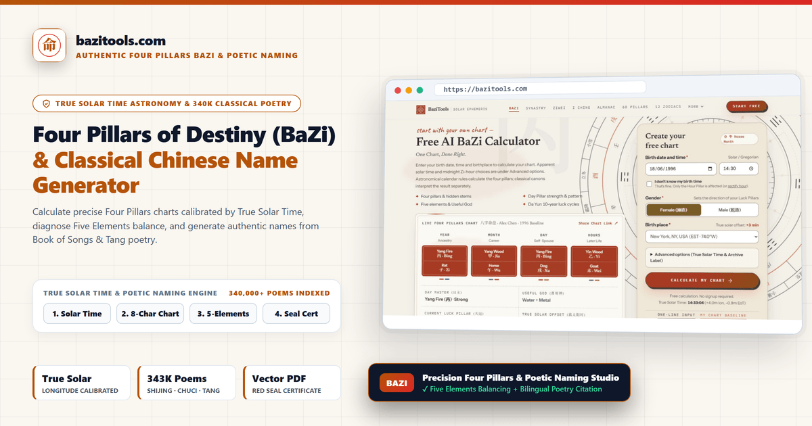
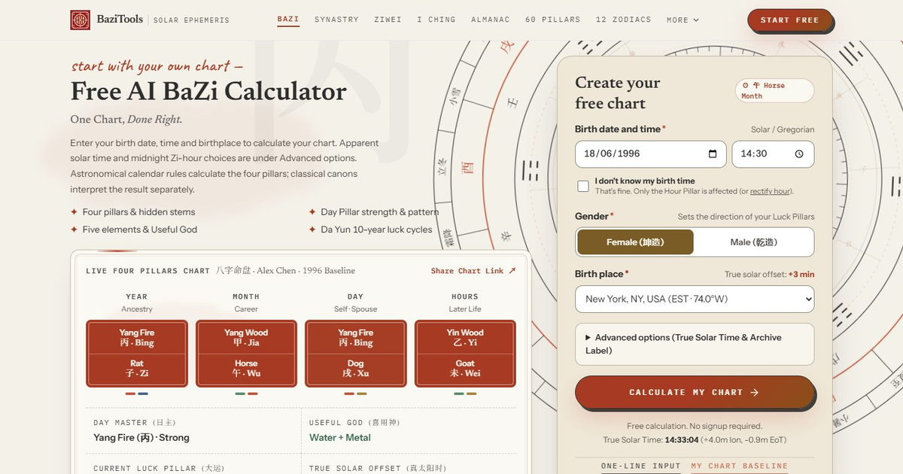

# ☯️ BaziTools MCP Server (`com.bazitools/mcp`)

[](https://bazitools.com)

Official stateless **Model Context Protocol (MCP)** server and Agent Skill for **[BaziTools (bazitools.com)](https://bazitools.com)**.

- **Official Website**: [https://bazitools.com](https://bazitools.com)
- **Streamable HTTP MCP Endpoint**: `https://bazitools.com/api/mcp` (Public read-only tools, zero API key required)
- **Official MCP Registry ID**: `com.bazitools/mcp` (Domain-verified via Ed25519)
- **License**: MIT

---

## ⚡ Quick Connect (Claude Desktop / Cursor / Windsurf / Grok / Hermes)

Add the remote Streamable HTTP endpoint directly to your MCP configuration:

```json
{
  "mcpServers": {
    "bazitools": {
      "type": "http",
      "url": "https://bazitools.com/api/mcp"
    }
  }
}
```

### Install Agent Skill (`skills.sh` / Claude Code / Cursor)

```bash
npx skills add AbigailDavised/bazitools-mcp
```

---

## 🖼️ Interactive Web Workbench Preview

[](https://bazitools.com)

## 🔗 Key Capabilities & Direct Web Tools

- **[BaziTools Official Studio](https://bazitools.com)**: https://bazitools.com
- **[Ten Day Masters Reference](https://bazitools.com/day-master)**: https://bazitools.com/day-master
- **[Four Pillars Structural Guide](https://bazitools.com/pillars)**: https://bazitools.com/pillars
- **[Ten Gods (Shi Shen) Matrix](https://bazitools.com/ten-gods)**: https://bazitools.com/ten-gods
- **[Stem & Branch Interactions](https://bazitools.com/interactions)**: https://bazitools.com/interactions
- **[Auxiliary Stars (Shen Sha)](https://bazitools.com/stars)**: https://bazitools.com/stars

---

## 🧪 Live JSON-RPC 2.0 Verification

```bash
curl -s -X POST https://bazitools.com/api/mcp \
  -H "Content-Type: application/json" \
  -d '{"jsonrpc":"2.0","id":1,"method":"tools/call","params":{"name":"calculate_bazi_four_pillars","arguments":{"birthDate":"1994-08-15","birthHour":14,"gender":"female"}}}'
```
